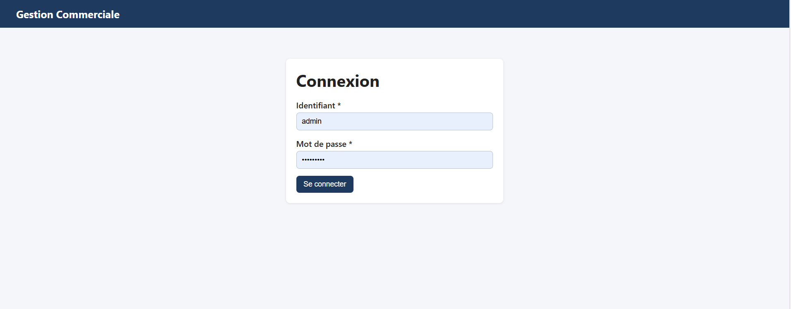
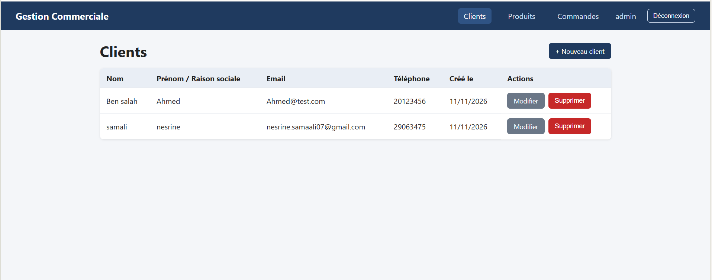
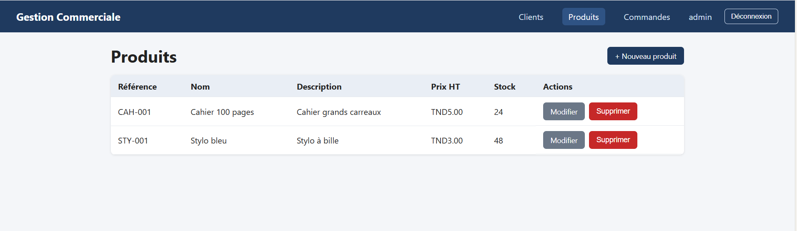
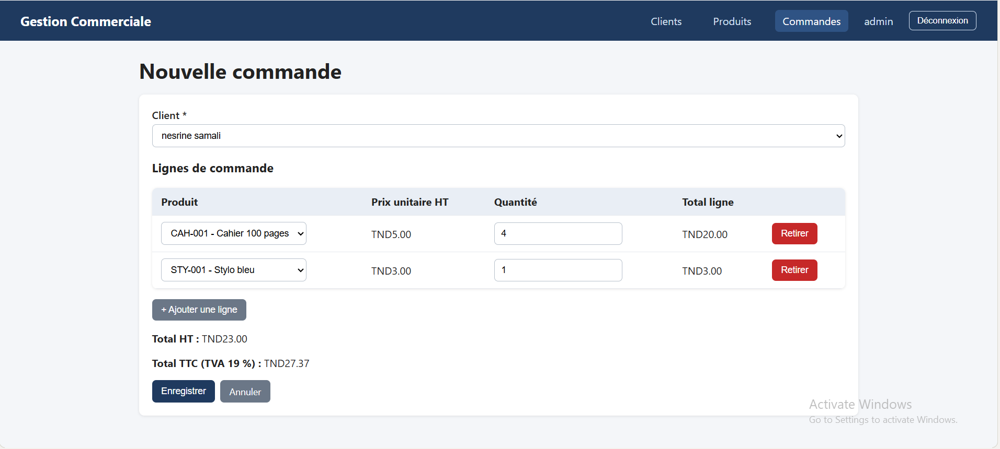
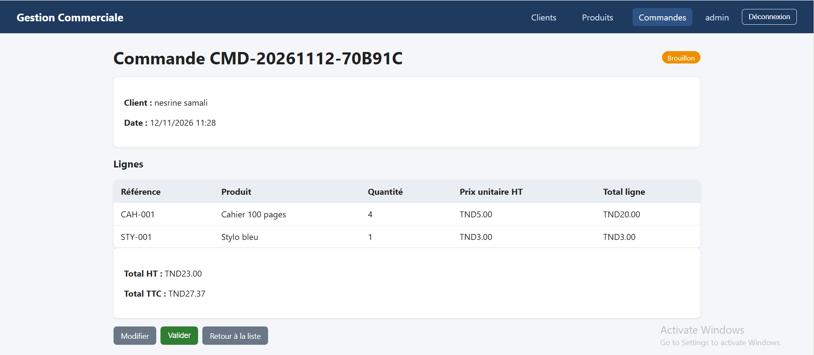

# Mini projet de gestion commerciale

Application de gestion des clients, produits et commandes.
Back-end .NET 8 (API REST), front-end Angular, base de données SQL Server.

## Prérequis

- .NET 8 SDK
- Node.js 22 (LTS) et Angular CLI (`npm install -g @angular/cli`)
- SQL Server Express (instance `localhost\SQLEXPRESS`)

## Base de données

Deux options :

1. **Automatique (recommandé)** : les migrations Entity Framework créent la base.
   ```
   cd GestionCommerciale.Api
   dotnet ef database update
   ```
2. **Script SQL** : exécuter `database/create-database.sql` dans SSMS.

La chaîne de connexion est dans `GestionCommerciale.Api/appsettings.json`
(`Server=localhost\SQLEXPRESS`, authentification Windows). Adapter si besoin.

## Lancer le back-end

```
cd GestionCommerciale.Api
dotnet run --launch-profile https
```

L'API écoute sur `https://localhost:7246`.
Documentation Swagger : `https://localhost:7246/swagger`

## Lancer le front-end

```
cd gestion-commerciale-ui
npm install
ng serve
```

Ouvrir `http://localhost:4200`. L'adresse de l'API est définie dans
`src/app/core/api.config.ts`.

## Connexion

L'application est protégée par une authentification JWT.

- Identifiant : `admin`
- Mot de passe : `Admin123!`

Ce compte est créé automatiquement au premier démarrage du back-end.
Dans Swagger : appeler `POST /api/auth/login`, copier le token, puis cliquer
sur **Authorize**.

## Architecture

- **Back-end** : Controllers → Services (logique métier) → AppDbContext (EF Core).
  DTOs avec validations, gestion centralisée des erreurs (middleware),
  authentification JWT.
- **Front-end** : pages Angular (connexion, clients, produits, commandes),
  services HTTP, intercepteurs (token JWT, erreurs), guard de protection
  des routes, notifications de succès et d'erreur.

## Règles de gestion appliquées

- Total ligne = quantité × prix unitaire ; total HT = somme des lignes ;
  total TTC = HT × 1,19 (TVA 19 %).
- Commande impossible sans client ; quantité supérieure à 0 ;
  quantité limitée au stock disponible.
- Le stock diminue à la validation de la commande.
- Une commande validée ne peut plus être modifiée ni supprimée.
- Un client ayant des commandes, ou un produit présent dans une commande,
  ne peut pas être supprimé.
- La référence d'un produit est unique.

## Captures d'écran





